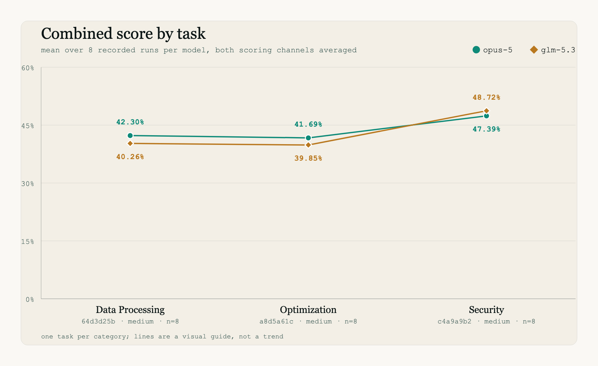
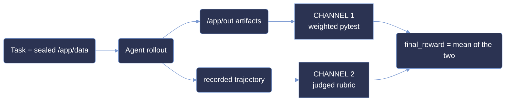

<p align="center">
  <picture>
    <source type="image/svg+xml" srcset="images/hero.svg">
    
  </picture>
</p>

<p align="center">
  <strong>Measuring agentic terminal capability on sealed, offline reconstruction tasks.</strong>
</p>

<p align="center">
  <a href="#summary"></a>
  <a href="#scoring-methodology"></a>
  <a href="#difficulty-tiers"></a>
  <a href="#summary"></a>
</p>

<p align="center"><sub>
  <a href="#summary">Summary</a> · <a href="#repository-layout">Layout</a> · <a href="#difficulty-tiers">Tiers</a> · <a href="#results">Results</a> · <a href="#analysis">Analysis</a> · <a href="#coverage">Coverage</a> · <a href="#dataset-structure">Dataset</a> · <a href="#trajectory-structure">Trajectories</a> · <a href="#scoring-methodology">Scoring</a> · <a href="#reproduction">Reproduction</a> · <a href="#limitations">Limitations</a>
</sub></p>

# ANUBIS: 3-Task Terminal Evaluation Sample

**ANUBIS measures agentic capability on sealed terminal tasks - problems whose governing
parameters are deliberately withheld and must be recovered from the shipped evidence before any
answer can be produced.**

Each task hands the agent a read-only corpus under `/app/data` and a set of output paths under
`/app/out`. Nothing tells the agent which layer wins a precedence conflict, which rows in a shipped
table are authoritative, or which rounding rule governs a derived quantity. Those facts are
recoverable from the corpus and nowhere else, so an agent that guesses the shape of the answer
without reading the evidence produces something well-formed and wrong.

This repository contains three complete task bundles and every rollout recorded against them:
**3 tasks × 2 models × 8 runs = 48 rollouts**. Each rollout ships its full trajectory, its graded
artifacts, and both scoring channels. Every figure below is derived from those bytes and can be
recomputed with the snippets in [Reproduction](#reproduction).

## Summary

| | |
| --- | --- |
| Tasks | 3, one per category, all Python 3 standard library |
| Models | `opus-5`, `glm-5.3` |
| Runs per cell | 8 - a full pass@8 grid, 2 models × 8 runs for each of the 3 tasks = **48 total**, no gaps |
| Scoring | two independent channels, averaged |
| Channel 1 | weighted pytest over the artifacts in `/app/out` |
| Channel 2 | judged rubric over the recorded trajectory |
| Reward | `final_reward`, percentage points in [-100, 100] - mean of the two channels |
| Rubric reviewer | one named reviewer per task, recorded in `evaluated_by` |
| Full solves | **0 of 48** - no run passed every required test |

| Cohort figure | `opus-5` | `glm-5.3` |
| --- | --- | --- |
| mean combined score | **43.79%** | 42.95% |
| mean pytest channel | 32.97% | **33.84%** |
| mean rubric channel | **54.61%** | 52.05% |
| mean agent cost / run | $4.02 | **$2.09** |
| mean steps / run | **41.1** | 101.6 |

Bold marks the leading cohort on each row.
| total cost over 24 runs | $96.43 | $50.25 |

The reward can fall below zero because both channels subtract penalties from a positive-only
denominator: a cheat detector that fires subtracts its weight from the pytest channel, and a
violated negative rubric criterion subtracts its score from the rubric channel.

## Repository layout

```
.
├── 64d3d25b-74db-5ac0-a47d-f1b1073cca81/   Data Processing
├── a8d5a61c-4126-58f3-8e29-edb360f79699/   Optimization
├── c4a9a9b2-0818-5b05-9829-3a208c74638b/   Security
├── images/
│   ├── hero.svg · hero.png
│   ├── score_by_task-light.svg · score_by_task-dark.svg · score_by_task-light.png
│   └── tasks_by_category-light.svg · tasks_by_category-dark.svg · tasks_by_category-light.png
├── LICENSE
└── README.md
```

Each task directory is a self-contained bundle: the environment that builds the sealed corpus, the
instruction handed to the agent, the reference solution, the two graders, and all 16 recorded
rollouts.

## Difficulty tiers

`difficulty` is a score band, not an opinion. A task's tier is the band its `opus-5` mean
combined score falls into, measured over the 8 recorded runs:

| tier | interval | rule |
| --- | --- | --- |
| `trivial` | `[87.5, 100]` | mean combined score ≥ 87.5% |
| `easy` | `[50, 87.5)` | ≥ 50% and < 87.5% |
| `medium` | `[37.5, 50)` | ≥ 37.5% and < 50% |
| `hard` | `[25, 37.5)` | ≥ 25% and < 37.5% |
| `expert` | `[-100, 25)` | < 25% |

Every bound is **lower-inclusive, upper-exclusive**: a score of exactly 50.0 is `easy`, exactly 37.5
is `medium`, exactly 25.0 is `hard`.

**All three tasks land in `medium`.** Under pass@8 the ladder collapsed:

| uuid | category | opus-5 mean over 8 runs | tier |
| --- | --- | --- | --- |
| `64d3d25b` | Data Processing | 42.30% | `medium` |
| `a8d5a61c` | Optimization | 41.69% | `medium` |
| `c4a9a9b2` | Security | 47.39% | `medium` |

This is worth stating plainly rather than hiding. Three tasks cannot span five tiers, and a sample
this small has no obligation to. The tier is reported because it is the rule the corpus is graded
against, not because the three tasks were selected to differ on it. The snippet in
[Reproduction](#reproduction) re-derives all three labels from the shipped bytes.

## Results

### Combined score by task

<picture>
  <source media="(prefers-color-scheme: dark)" srcset="images/score_by_task-dark.svg" type="image/svg+xml">
  <source media="(prefers-color-scheme: light)" srcset="images/score_by_task-light.svg" type="image/svg+xml">
  
</picture>

| task | category | model | pytest | rubric | combined |
| --- | --- | --- | --- | --- | --- |
| `64d3d25b` | Data Processing | `opus-5` | 29.60% | 55.00% | **42.30%** |
| `64d3d25b` | Data Processing | `glm-5.3` | 35.52% | 45.00% | 40.26% |
| `a8d5a61c` | Optimization | `opus-5` | 42.14% | 41.25% | **41.69%** |
| `a8d5a61c` | Optimization | `glm-5.3` | 39.28% | 40.42% | 39.85% |
| `c4a9a9b2` | Security | `opus-5` | 27.19% | 67.58% | 47.39% |
| `c4a9a9b2` | Security | `glm-5.3` | 26.70% | 70.74% | **48.72%** |

**The three tasks are closer than eight runs of noise.** The six cell means span 39.85% to 48.72%,
a range of under nine points, and the two models finish 0.84 points apart over 24 runs each. On this
corpus the task identity matters more than the model choice, and neither matters much.

**glm-5.3 wins exactly one cell.** On `c4a9a9b2` it scores 48.72% against opus-5's 47.39% - the only
task where the cheaper model finishes ahead on combined score. It does so on the rubric channel
(70.74% against 67.58%) while losing the pytest channel, which is the reverse of its usual pattern.

**The two channels disagree about which model is better.** glm-5.3 wins the pytest channel
(33.84% against 32.97%) while opus-5 wins the rubric channel (54.61% against 52.05%). Averaging them
hands the overall result to opus-5 by 0.84 points. A single-channel benchmark built from the same
runs would have reported the opposite winner.

## Analysis

**Eight runs were necessary, and the spread proves it.** On `64d3d25b` opus-5's eight combined
scores range from 27.36% to 49.86%, a population standard deviation of 7.34 points. A single run
could have placed that task in `hard`, `medium`, or within a rounding error of `easy`. The task is
steady elsewhere - `a8d5a61c` opus-5 has a standard deviation of 1.68 - so the instability is a
property of the task, not of the harness.

**Effort does not track score.** glm-5.3 spends 101.6 steps per run against opus-5's 41.1 - roughly
2.5× the interaction - and still finishes 0.84 points lower overall. It is the cheaper cohort while
doing so: $2.09 per run against opus-5's $4.02, $50.25 against $96.43 across 24 runs each. That is a
48% saving for less than one point of combined score.

**The ceiling was never reached.** Zero of 48 runs passed every required test. The best pytest
channel anywhere in the corpus is 52.43%, on `c4a9a9b2` `glm-5.3` run 8. Only the reference solution
takes that channel to its maximum, which is what makes these tasks usable as a discriminating
benchmark rather than a saturated one.

**The rubric channel is systematically more generous than the pytest channel**, by 21.6 points for
opus-5 and 18.2 for glm-5.3. Both channels are graded against the same task, so this is not noise:
the rubric rewards recognisable process in the trajectory, while pytest only rewards artifacts that
are byte-correct. An agent can reason its way through a task convincingly and still ship the wrong
file.

**Anti-cheat detectors fired six times across 48 runs, all on `c4a9a9b2`.**
`test_negative_weight_fake_cli_transcript` fired five times and
`test_negative_weight_hardcoded_sample_answers` once. Each firing subtracts its weight from that
run's pytest channel while the denominator stays positive-only, so a run that fabricates evidence
scores strictly below one that simply fails. The remaining 42 rollouts tripped nothing, and no
negative rubric criterion was violated anywhere in the corpus.

## Coverage

<picture>
  <source media="(prefers-color-scheme: dark)" srcset="images/tasks_by_category-dark.svg" type="image/svg+xml">
  <source media="(prefers-color-scheme: light)" srcset="images/tasks_by_category-light.svg" type="image/svg+xml">
  
</picture>

Three tasks, three distinct categories, one task each. Every task is Python 3 with the standard
library only - no third-party imports appear in any grader or reference solution, so the graders run
anywhere a bare interpreter runs.

### Full task list

| uuid | category | tier | tests | positive points | detectors | rubric criteria |
| --- | --- | --- | --- | --- | --- | --- |
| `64d3d25b-74db-5ac0-a47d-f1b1073cca81` | Data Processing | `medium` | 76 | 272 | 4 | 16 |
| `a8d5a61c-4126-58f3-8e29-edb360f79699` | Optimization | `medium` | 75 | 267 | 4 | 15 |
| `c4a9a9b2-0818-5b05-9829-3a208c74638b` | Security | `medium` | 33 | 103 | 4 | 27 |

184 tests and 12 cheat detectors across the corpus, counted per task because every grader is
task-local. No two tasks share a grader: all three
`tests/test_weights.json` files differ.

## Dataset structure

```
<uuid>/
├── README.md              maintainer notes, never shown to the agent
├── instruction.md         the brief handed to the agent by the harness
├── task.toml              schema 1.4 - category, difficulty, timeouts, pinned images
├── environment/
│   ├── Dockerfile         builds the agent image
│   └── data/              the sealed corpus, baked into the image layer at /app/data
├── solution/
│   ├── TRUTH.md           the governing rules, stated plainly
│   ├── solve.py           reference solver
│   └── solve.sh           oracle dispatcher
├── tests/
│   ├── Dockerfile         builds the verifier image
│   ├── test.sh            entrypoint, writes /logs/verifier/reward.json
│   ├── test_output.py     channel 1 - the weighted pytest grader
│   ├── test_weights.json  per-test weights, negative for cheat detectors
│   └── rubric.json        channel 2 - the criteria list
└── trajectories/          16 recorded rollouts, 8 per model
```

The agent never sees `tests/` or `solution/`. The agent image is built from `environment/` alone, so
those trees are unreachable by `COPY`. The build does reach the network - Debian mirrors via
`apt-get`, astral.sh for `uv`, and PyPI for `openhands-sdk`, `openhands-tools` and `fastapi` - but it
fetches only the agent's own toolchain, never task data, tests or reference answers.

Both images are pinned by digest in `task.toml`, under `[environment].docker_image` and
`[verifier.environment].docker_image`, so a rerun resolves the same bytes rather than rebuilding.
Both run with `network_mode = "no-network"`.

## Trajectory structure

```
trajectories/
├── opus-5/
│   ├── pass_summary.json      runs, the three averages, and a per_run breakdown
│   ├── run_1/ … run_8/
│   │   ├── agent/trajectory.json    every step, plus final_metrics
│   │   ├── artifacts/               what the agent wrote to /app/out
│   │   │   ├── app/out/
│   │   │   ├── logs/                reserved for agent-side logs; empty in all runs
│   │   │   └── manifest.json
│   │   ├── config.json              model, temperature, iteration cap
│   │   ├── report.json              both channels and final_reward
│   │   ├── result.json              harness-level trial record
│   │   └── verifier/
│   │       ├── ctrf.json            per-test results in CTRF form; `tool.version`
│   │       │                        is present only where the grader pins pytest
│   │       ├── reward.json
│   │       ├── score.json
│   │       ├── test-stdout.txt
│   │       └── usage.json           tokens and cost for the run
└── glm-5.3/                    same shape
```

`report.json` carries the three numbers this document is built on: `test_weights_percentage`,
`rubric_weights_percentage`, and `final_reward` - their mean. Its `evaluated_by` field carries the
email of the reviewer who graded that run's rubric.

Step counts are derived as `len(trajectory["steps"])`; `final_metrics` records token totals and cost
but not a step count. `result.json` also carries a reward under `verifier_result.rewards.reward`,
but that is the pytest channel alone normalised to [0, 1] - it is not the figure this document
reports.

## Scoring methodology



### What "pass rate" means here

There is no binary pass. Every run earns partial credit on both channels:

```
final_reward = (test_weights_percentage + rubric_weights_percentage) / 2
pass_rate(task, model) = mean of final_reward over that model's 8 recorded runs
```

No rescaling is applied - `final_reward` is already in percentage points. A "pass rate" of 43.79%
means the average run earned 43.79% of the available credit, not that 43.79% of runs succeeded. By
the binary measure, the success rate on this corpus is zero.

### Channel 1 – Weighted pytest

`tests/test_output.py` grades the artifacts the agent wrote to `/app/out`. Each test carries a
weight in `tests/test_weights.json`:

```
test_weights_percentage = 100 × Σ(weight of passing tests) / Σ(positive weights)
```

Negative-weight tests are cheat detectors. For those, passing means the detector *fired* - it found
hardcoded answers, a fabricated CLI transcript, a dynamically generated config, or network
material - and its weight is subtracted. The denominator counts positive weights only, so a run
that fabricates evidence can score below a run that does nothing.

### Channel 2 – Judged rubric

`tests/rubric.json` lists criteria evaluated against the recorded trajectory rather than the
artifacts. Each carries a `score` and an `is_positive` flag:

```
rubric_weights_percentage = 100 × [Σ(score of satisfied positive criteria)
                                 − Σ(score of violated negative criteria)] / Σ(positive scores)
```

Positive criteria reward evidence of real work - reading the corpus before writing, deriving the
governing rule, validating output. Negative criteria penalise shortcuts. Every run records its
rubric reviewer in `evaluated_by`; one reviewer graded all 16 runs of a given task.

## Reproduction

Every snippet below runs from the repository root with a bare Python 3 interpreter and reads only
files shipped here.

**Re-derive each task's difficulty from its recorded runs:**

```bash
python3 -c "
import json,os,re
BANDS=[('trivial',87.5),('easy',50.0),('medium',37.5),('hard',25.0),('expert',0.0)]
def band(x):
    for n,lo in BANDS:
        if x>=lo: return n
    return 'expert'
for u in sorted(d for d in os.listdir('.') if os.path.isdir(d) and len(d) == 36 and d[8] == '-'):
    t=open(os.path.join(u,'task.toml')).read()
    dec=re.search(r'difficulty = .([a-z]+).',t).group(1)
    s=json.load(open(os.path.join(u,'trajectories','opus-5','pass_summary.json')))
    m=s['average_combined_score']
    print(u[:8],'declared='+dec,'opus-5=%6.2f'%m,'band='+band(m),'OK' if band(m)==dec else 'MISMATCH')"
# -> 64d3d25b declared=medium opus-5= 42.30 band=medium OK
# -> a8d5a61c declared=medium opus-5= 41.69 band=medium OK
# -> c4a9a9b2 declared=medium opus-5= 47.39 band=medium OK
```

**Recompute the headline rate for each model:**

```bash
python3 -c "
import json,glob,collections
by=collections.defaultdict(list)
for p in glob.glob('*/trajectories/*/run_*/report.json'):
    r=json.load(open(p)); by[r['model']].append(r['final_reward'])
for m,v in sorted(by.items()):
    print(m,{'runs':len(v),'pass_rate':round(sum(v)/len(v),2)})"
# -> glm-5.3 {'runs': 24, 'pass_rate': 42.95}
# -> opus-5 {'runs': 24, 'pass_rate': 43.79}
```

**Count the grid, the full solves, and the rubric reviewers:**

```bash
python3 -c "
import json,glob
R=[json.load(open(p)) for p in glob.glob('*/trajectories/*/run_*/report.json')]
print({'runs':len(R),
       'solved':sum(r['pytest']['reward']>=1.0 for r in R),
       'reviewers':sorted({r['evaluated_by'] for r in R})})"
# -> {'runs': 48, 'solved': 0, 'reviewers': ['dinshi.jain@ethara.ai', 'poonam.chourey@ethara.ai', 'sugam.agrawal@ethara.ai']}
```

**Verify the composition `final_reward = (pytest + rubric) / 2`:**

```bash
python3 -c "
import json,glob
P=glob.glob('*/trajectories/*/run_*/report.json')
ok=0; worst=0.0
for p in P:
    r=json.load(open(p))
    d=abs((r['test_weights_percentage']+r['rubric_weights_percentage'])/2-r['final_reward'])
    worst=max(worst,d); ok+=d<=0.01
print(str(ok)+'/'+str(len(P))+' ok, worst='+str(round(worst,3)))"
# -> 48/48 ok, worst=0.005
```

**Split the two channels per task and model:**

```bash
python3 -c "
import json,os
for u in sorted(d for d in os.listdir('.') if os.path.isdir(d) and len(d) == 36 and d[8] == '-'):
    for m in ('opus-5','glm-5.3'):
        s=json.load(open(os.path.join(u,'trajectories',m,'pass_summary.json')))
        print(u[:8],'%-14s'%m,'pytest=%6.2f'%s['average_test_weights_percentage'],
              'rubric=%6.2f'%s['average_rubric_weights_percentage'],
              'final=%6.2f'%s['average_combined_score'])"
# -> 64d3d25b opus-5         pytest= 29.60 rubric= 55.00 final= 42.30
# -> 64d3d25b glm-5.3        pytest= 35.52 rubric= 45.00 final= 40.26
# -> a8d5a61c opus-5         pytest= 42.14 rubric= 41.25 final= 41.69
# -> a8d5a61c glm-5.3        pytest= 39.28 rubric= 40.42 final= 39.85
# -> c4a9a9b2 opus-5         pytest= 27.19 rubric= 67.58 final= 47.39
# -> c4a9a9b2 glm-5.3        pytest= 26.70 rubric= 70.74 final= 48.72
```

**Total agent effort across the sample:**

```bash
python3 -c "
import json,glob
M=[json.load(open(p)) for p in glob.glob('*/trajectories/*/run_*/agent/trajectory.json')]
print({'runs':len(M),'usd':round(sum(x['final_metrics']['total_cost_usd'] for x in M),2),
       'steps':sum(len(x['steps']) for x in M),
       'runs_with_cost':sum(x['final_metrics']['total_cost_usd']>0 for x in M)})"
# -> {'runs': 48, 'usd': 146.68, 'steps': 3426, 'runs_with_cost': 48}
```

**Count the graders and confirm no two tasks share one:**

```bash
python3 -c "
import json,glob,hashlib
w=[json.load(open(p)) for p in glob.glob('*/tests/test_weights.json')]
h={hashlib.sha256(open(p,'rb').read()).hexdigest() for p in glob.glob('*/tests/test_weights.json')}
print({'tests':sum(len(x) for x in w),
       'negative':sum(1 for x in w for v in x.values() if v<0),
       'distinct_graders':len(h)})"
# -> {'tests': 184, 'negative': 12, 'distinct_graders': 3}
```

**List every cheat detector that fired, with how often:**

```bash
python3 -c "
import json,glob,collections
c=collections.Counter()
for p in glob.glob('*/tests/test_weights.json'):
    u=p.split('/')[0]
    neg={k for k,v in json.load(open(p)).items() if v<0}
    for q in glob.glob(u+'/trajectories/*/run_*/report.json'):
        for t in json.load(open(q))['pytest']['tests']:
            if t['name'] in neg and t['passed']: c[(u[:8],t['name'])]+=1
print(sorted(c.items()))"
# -> [(('c4a9a9b2', 'test_negative_weight_fake_cli_transcript'), 5), (('c4a9a9b2', 'test_negative_weight_hardcoded_sample_answers'), 1)]
```

**Confirm no agent `Dockerfile` references the `tests/` or `solution/` trees:**

```bash
grep -rIlw -e 'tests' -e 'solution' */environment/Dockerfile | wc -l
# ->        0
```

The charts in `images/` plot the same numbers these snippets print: the `-light` and `-dark` SVGs
are the sources, and the `-light.png` files are browser-rendered exports of them.

## Limitations

**Three tasks is a small corpus, and the sample is not random.** These three were selected to cover
three distinct categories, not to be representative of terminal work in general. Treat the cohort
means as a description of this corpus, not as an estimate of the wider population.

**The difficulty ladder collapsed under pass@8.** All three tasks band `medium`, so this sample
cannot say anything about how the models behave on genuinely easy or genuinely expert work. A tier
spread would require more tasks, not more runs.

**Eight runs still leaves real uncertainty.** On `64d3d25b` opus-5's runs range from 27.36% to
49.86% with a population standard deviation of 7.34 points. The mean of eight draws from a distribution that
wide has a standard error of roughly 2.6 points, which is larger than the 0.84-point gap between the
two models. The model ranking in this sample should not be read as a general result.

**The ceiling was never reached by a model.** No run scored 100% on the pytest channel; the best is
52.43%. Only the reference solution takes that channel to its maximum. The corpus therefore measures
partial progress, and says nothing about how these models would compare on tasks they can finish.

**Sampling is not pinned to a reproducible point.** Both cohorts record `LLM_TEMPERATURE = "1.0"`,
so the temperature is matched across them, but no seed is recorded and provider-side sampling above
that knob is not guaranteed identical. Re-running will not reproduce these trajectories token for
token.

**The rubric channel was graded once.** Each run names its reviewer in `evaluated_by`. No second
pass and no inter-rater agreement were recorded, so the rubric scores carry the biases of a single
grading pass. The channel percentage is recomputable from the shipped `rubric[]` entries, but the
pass/fail marks themselves are judgements rather than measurements, so unlike the pytest channel the
marks cannot be re-derived from the corpus.

## License

MIT © 2026 Ethara.AI – see [LICENSE](LICENSE).

Task content, including the corpora under `environment/data/`, is released under the same terms.

<!-- trinity:lane-index:begin -->
GENERATED SECTION. DO NOT HAND-EDIT.

## Promoted set

| uuid | task_lane | sealed_at | stream |
| --- | --- | --- | --- |
| 64d3d25b-74db-5ac0-a47d-f1b1073cca81 | adopted | unsealed | none |
| a8d5a61c-4126-58f3-8e29-edb360f79699 | adopted | unsealed | none |
| c4a9a9b2-0818-5b05-9829-3a208c74638b | adopted | unsealed | none |

## Standing

| uuid | verdict |
| --- | --- |
| 64d3d25b-74db-5ac0-a47d-f1b1073cca81 | none |
| a8d5a61c-4126-58f3-8e29-edb360f79699 | none |
| c4a9a9b2-0818-5b05-9829-3a208c74638b | none |

## Screening roots

No screening root is recorded by reconcile.
<!-- trinity:lane-index:end -->
