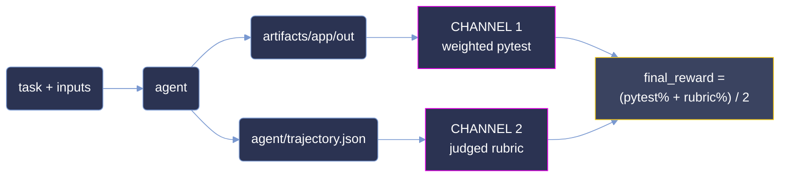

<p align="center">
  <picture>
    <source type="image/svg+xml" srcset="images/hero.svg">
    
  </picture>
</p>

<p align="center">
  <strong>Measuring agentic terminal capability on sealed, offline reconstruction tasks.</strong>
</p>

<p align="center">
  <a href="#summary"></a>
  <a href="#scoring-methodology"></a>
  <a href="#difficulty-tiers"></a>
  <a href="#reproduction"></a>
</p>

<p align="center"><sub>
  <a href="#summary">Summary</a> · <a href="#repository-layout">Layout</a> · <a href="#difficulty-tiers">Tiers</a> · <a href="#results">Results</a> · <a href="#analysis">Analysis</a> · <a href="#coverage">Coverage</a> · <a href="#dataset-structure">Dataset</a> · <a href="#trajectory-structure">Trajectories</a> · <a href="#scoring-methodology">Scoring</a> · <a href="#reproduction">Reproduction</a> · <a href="#limitations">Limitations</a>
</sub></p>

# ANUBIS: 3-Task Terminal Evaluation Sample

**ANUBIS measures agentic terminal capability on sealed reconstruction tasks, graded on the
artifacts an agent delivers and on the reasoning it recorded getting there.**

Each task hands an agent a directory of flat input files whose wire parameters are withheld, and
asks it to recover those parameters, settle a set of derived quantities to a stable assignment, and
write a fixed set of JSON artifacts to `/app/out`. Nothing is a lookup: the answer is not present in
the inputs, and the reference solution never enters the agent's environment. Grading runs in a
separate container against the delivered files, and a second channel grades the recorded trajectory
against a per-task rubric.

This sample is narrow and deep: **3 tasks × 2 models × 8 runs = 48 graded rollouts.** The budget goes
on repetition rather than breadth, so difficulty is a measured rate over eight attempts rather than a
single observation. The three tasks are one per tier – one `medium`, one `hard`, one `expert` –
selected so that each occupies a different band of claude-opus-5's measured pass rate.

**Not one of the 48 rollouts turned every required test green.** Strict all-or-nothing scoring is
therefore `0` everywhere and carries no signal. Throughout this document **pass rate is the mean
`final_reward` over a model's 8 runs on a task**, as a percentage:

```
pass_rate(task, model) = mean( final_reward over that model's 8 runs on the task )
```

**This is *not* pass@k.** It is a partial-credit rate: a run scoring 40% contributes 40, not 0. It is
the same number the difficulty bands are cut on.

> **This is a curated, quality-controlled sample of the ANUBIS corpus,** provided for evaluation. The
> dataset format, trajectory format and scoring are identical to the production benchmark.

## Summary

| Property         | Value                                                                       |
| :--------------- | :-------------------------------------------------------------------------- |
| Tasks            | **3**, across 3 distinct categories                                          |
| Models           | `opus-5` (`anthropic/claude-opus-5`) and `glm-5.3`                           |
| Runs & grid      | 8 per model per task = **48 total**; full 2 × 8 grid, no gaps                |
| Difficulty tiers | Banded on **opus-5**'s mean over 8 runs – one task per tier                  |
| Judge            | `gpt-5.6-sol`, sole judge on all 48 runs                                     |
| Score            | `final_reward` ∈ [0, 100] – the mean of two independent channels             |
| Channels         | Weighted pytest over delivered artifacts; judged rubric over the trajectory  |
| Environment      | Verifier runs in a **separate container** from the agent                     |
| Corpus size      | 1,020 files, 59.1 MB                                                         |

| metric | opus-5 | glm-5.3 |
|---|--:|--:|
| **pass rate** (mean `final_reward`) | **33.65%** | 32.63% |
| full-task pass rate (every test green) | 0% (0 / 24) | 0% (0 / 24) |
| mean pytest channel | **19.33%** | 17.39% |
| mean rubric channel | **47.97%** | 47.88% |
| mean agent cost / run | **$3.58** | $7.21 |
| mean steps / run | **36** | 89 |

## Repository layout

```
anubis-samples/
├── README.md                 # this document
├── LICENSE                   # MIT
├── images/                   # charts ship in -light and -dark variants
│   ├── hero.png
│   ├── pass_rate_by_tier-{light,dark}.png
│   ├── cost_by_tier-{light,dark}.png
│   └── tasks_by_category-{light,dark}.png
└── <uuid>/                   # one self-contained directory per task (3)
    ├── task.toml, instruction.md, environment/, solution/, tests/
    └── trajectories/
        ├── claude-opus-5/run_1 … run_8
        └── glm-5.3/run_1 … run_8
```

Task directories are named by UUID. No task name, slug or codename appears anywhere in the tree –
the identifier is the UUID and nothing else.

## Difficulty tiers

A tier is a **band on a measured rate** – the mean `final_reward` over eight runs:

| band | mean `final_reward` |
|---|---|
| `trivial` | ≥ 87.5% |
| `easy` | [50%, 87.5%) |
| `medium` | [37.5%, 50%) |
| `hard` | [25%, 37.5%) |
| `expert` | < 25% |

| tier | tasks |
|---|--:|
| `medium` | 1 |
| `hard` | 1 |
| `expert` | 1 |

`[metadata].difficulty` is the **only** difficulty label `task.toml` ships, and it is cut on
**opus-5**'s measured rate. That single axis is deliberate: both models are then reported against
the same tier assignment, so a per-tier row is directly comparable across models rather than each
model being graded against its own private banding. Rebanding all three labels from the shipped
scores reproduces all three exactly – see [Reproduction](#reproduction).

No task lands in `trivial` or `easy` under either model.

## Results

### Partial-credit pass rate by opus-5 tier

| tier | n | opus-5 pass rate | opus-5 pytest | opus-5 cost/run | glm-5.3 pass rate | glm-5.3 pytest | glm-5.3 cost/run |
|---|--:|--:|--:|--:|--:|--:|--:|
| `medium` | 1 | 43.48% | 14.23% | $4.09 | 48.41% | 18.98% | $9.09 |
| `hard` | 1 | 34.57% | 5.22% | $5.44 | 33.38% | 1.41% | $9.18 |
| `expert` | 1 | 22.91% | 38.54% | $1.21 | 16.11% | 31.77% | $3.35 |
| **overall** | **3** | **33.65%** | **19.33%** | **$3.58** | **32.63%** | **17.39%** | **$7.21** |

<picture>
  <source type="image/svg+xml" media="(prefers-color-scheme: dark)" srcset="images/pass_rate_by_tier-dark.svg">
  <source type="image/svg+xml" srcset="images/pass_rate_by_tier-light.svg">
  <source media="(prefers-color-scheme: dark)" srcset="images/pass_rate_by_tier-dark.png">
  <source media="(prefers-color-scheme: light)" srcset="images/pass_rate_by_tier-light.png">
  
</picture>

**Both models fall monotonically across the three tiers.** opus-5 goes 43.48 → 34.57 → 22.91 and
glm-5.3 goes 48.41 → 33.38 → 16.11. Since the tiers were cut on opus-5 alone, its monotonicity is
close to definitional; glm-5.3 reproducing the same ordering on an assignment it had no part in is
the informative half. The two models disagree on the `medium` task – glm-5.3 leads it by 4.93 points
– yet glm-5.3 still finishes 1.02 points lower overall, because it gives back more on `expert`.

**The pytest channel does not follow the tier at all.** It runs 14.23 → 5.22 → 38.54 for opus-5: the
`expert` task carries the *highest* artifact score in the corpus and the `hard` task the lowest. The
tier ordering is therefore carried by the rubric channel, not by the tests. Section
[Scoring methodology](#scoring-methodology) sets out what each channel is measuring, and
[Analysis](#analysis) explains why the two disagree.

**Cost does not track difficulty for either model.** opus-5 spends $4.09 → $5.44 → $1.21 as the tier
hardens, and glm-5.3 $9.09 → $9.18 → $3.35 – both non-monotonic, both cheapest on the hardest task.
Cost here is a function of the agent time budget and the size of the input corpus, not of how hard
the task is: the `expert` task ships a 7,200-second agent timeout against 21,600 for the other two,
and its agents stop three to five times sooner. Across the sample, 48 runs consumed **$258.77**,
3,022 steps, 242.19 M input tokens and 3.87 M output tokens.

## Analysis

**Partial credit turns an unsolved corpus into a ranked one.** Zero of 48 rollouts turned every
required test green, so a strict pass/fail metric reports 0% for both models and separates nothing.
The same 48 rollouts under partial credit separate the models by 1.02 points overall and the tasks
by 20.57 points end to end. The signal was always in the runs; binary scoring discards it.

**Two independent channels catch different failures.** The `expert` task scores 38.54% on tests and
3.86% on rubric; the `hard` task scores 3.31% on tests and 64.63% on rubric. An agent can satisfy a
sizeable share of the artifact contract while reasoning poorly about why, and it can reason well
about a problem it then fails to implement. A single-channel benchmark reports one of those two
failures and is blind to the other; the ranking flips depending on which one you pick.

**Eight runs make the label a measurement.** Per-run `final_reward` spans 11.72 to 56.00 across the
sample, and the pytest channel alone spans 0.56 to 43.75. A single rollout could place the same task
in three different bands. Averaging eight attempts is what makes `difficulty` a property of the task
rather than a property of the run that happened to be sampled.

These separations hold because the grading resists gaming. The reference solution never enters the
agent's environment; the verifier runs in a separate container from the agent; 12 of the 98 pytest
items carry negative weight, so fabricating output is scored worse than emitting nothing; and each
task ships its own grader – three distinct `test_weights.json` digests across three tasks, with no
shared template. Recomputing `final_reward` from its two channels reproduces all 48 runs.

## Coverage

<picture>
  <source type="image/svg+xml" media="(prefers-color-scheme: dark)" srcset="images/tasks_by_category-dark.svg">
  <source type="image/svg+xml" srcset="images/tasks_by_category-light.svg">
  <source media="(prefers-color-scheme: dark)" srcset="images/tasks_by_category-dark.png">
  <source media="(prefers-color-scheme: light)" srcset="images/tasks_by_category-light.png">
  
</picture>

Three tasks across three distinct categories – Debugging, Games and System Administration – with no
category repeated. Graders total **98 pytest items** (86 positive, 12 negative) and **49 rubric
criteria**, and the tasks declare **31 artifacts** between them. Per-task grader size ranges from 18
to 45 pytest items and 16 to 17 rubric criteria. All three are pure Python standard library, run
offline against flat input files checked into `environment/data/`. Agent time budgets are 21,600
seconds for two tasks and 7,200 for the third; verifier budgets are 2,700, 2,700 and 3,600 seconds.

### Full task list

| uuid | category | pytest (+/−) | rubric | opus-5 | glm-5.3 | tier |
|---|---|--:|--:|--:|--:|---|
| `45421e59` | Debugging | 31 / 4 | 16 | 43.48% | 48.41% | `medium` |
| `cffe140f` | Games | 41 / 4 | 16 | 34.57% | 33.38% | `hard` |
| `51304c02` | System Administration | 14 / 4 | 17 | 22.91% | 16.11% | `expert` |

Tier is anchored to opus-5. The `glm-5.3` column is that model's rate on the identical task under
the identical grader, not a re-banding – it is included so the two can be read against one shared
assignment.

## Dataset structure

```
<uuid>/
├── task.toml                 # metadata, difficulty, artifact contract, timeouts
├── instruction.md            # the prompt the agent receives, verbatim
├── environment/
│   ├── Dockerfile            # python:3.12-slim + a handful of CLI tools
│   └── data/                 # flat input files the agent reads
├── solution/
│   ├── solve.py              # reference solution – verifier-side only
│   ├── solve.sh              # entrypoint wrapper
│   └── TRUTH.md              # answer key and derivation
└── tests/
    ├── Dockerfile            # separate verifier image
    ├── test_output.py        # pytest suite over /app/out
    ├── test_weights.json     # per-test weights, positive and negative
    ├── rubric.json           # judged criteria over the trajectory
    └── test.sh               # verifier entrypoint
```

The agent sees `instruction.md` and `environment/data/` and nothing else. `solution/` and `tests/`
are verifier-side: the reference implementation and the answer key never enter the agent's
container, which is what closes the oracle-replay path. `task.toml` carries `schema_version = "1.1"`,
the declared artifact list, `[metadata].difficulty`, separate agent and verifier timeouts, and
`environment_mode = "separate"` – the verifier is built and run as its own image.

`allow_internet` is `true` in all three tasks. No run used it: the tasks are self-contained by
construction, every input is checked into `environment/data/`, and an audit of all 48 recorded
trajectories found zero outbound network commands.

## Trajectory structure

```
<uuid>/trajectories/<model>/run_N/
├── config.json               # agent + verifier configuration for this run
├── result.json               # harness envelope: timings, status, config snapshot
├── report.json               # the scores – both channels and final_reward
├── agent/
│   └── trajectory.json       # full step-by-step record, with final_metrics
├── artifacts/
│   ├── app/out/              # exactly what the agent delivered
│   └── manifest.json         # source → destination map with per-file status
└── verifier/
    ├── ctrf.json             # per-test pass/fail in CTRF form
    ├── score.json            # rubric verdicts, per criterion
    ├── reward.json           # the single reward scalar
    └── test-stdout.txt       # raw pytest output
```

`report.json` carries `test_weights_percentage`, `rubric_weights_percentage`, `final_reward`,
`judge_model`, `judge_usage`, `run_index`, `model` and the raw `pytest` block. `agent/trajectory.json`
carries `final_metrics` with `total_cost_usd`, `total_steps`, `total_prompt_tokens`,
`total_completion_tokens`, `total_cached_tokens` and `total_thinking_tokens` – every cost and effort
figure in this document is summed from that field.

`artifacts/app/out/` is the delivered estate exactly as the agent left it, and is what the pytest
channel grades. A missing `app/` directory is a real outcome, not a packaging fault: it means that
run produced no output.

## Scoring methodology

Two channels are computed per run over two different objects. They are averaged into the headline
number with equal weight.



### What "pass rate" means here

`final_reward` is `0` under strict all-or-nothing scoring on every one of the 48 runs, so a
conventional pass rate reports 0% for both models and ranks nothing. Every rate in this document is
instead the partial-credit mean:

```
pass_rate(task, model) = mean( final_reward over that model's 8 runs on the task )
```

Aggregated as an unweighted mean over runs, then over tasks. It is the same number the bands in
[Difficulty tiers](#difficulty-tiers) are cut on.

### Channel 1 – Weighted pytest

`tests/test.sh` builds a separate verifier image and runs `test_output.py` against
`artifacts/app/out/`. Each test carries a weight in `test_weights.json`. Across the three tasks there
are **98 items: 86 positive, totalling the achievable score, and 12 negative**. Negative items fire
on plausible wrong answers – a fabricated file, a value that looks right but was not derived – so
guessing scores below silence. The channel is `sum(passed weights) / sum(positive weights)`,
clamped at zero. The best single run in the corpus reached 43.75%.

### Channel 2 – Judged rubric

`tests/rubric.json` holds **49 criteria** across the three tasks, judged by `gpt-5.6-sol` against
`agent/trajectory.json` – the recorded reasoning, not the delivered files. Each criterion is scored
independently and carries an importance weight; `verifier/score.json` records the per-criterion
verdict with a justification on every failure. The channel is the weighted satisfaction rate.
`judge_model` is `gpt-5.6-sol` on all 48 runs with no fallback, and judging consumed 1.98 M input
and 0.144 M output tokens.

The two channels compose with equal weight:

```
final_reward = (test_weights_percentage + rubric_weights_percentage) / 2
```

Verified arithmetically on every run, within the two decimal places the fields ship at – for example
`45421e59` opus-5 run 1: (14.23 + 72.73) / 2 = 43.48 exactly.

## Reproduction

Every figure re-derives from the shipped bytes; no re-execution is needed. All snippets are Python
standard library only, run from the repository root.

**Assert the grid is complete, re-derive every tier, and reproduce the headline rates:**

```python
import json, glob, os, collections

BANDS = [(87.5, "trivial"), (50.0, "easy"), (37.5, "medium"), (25.0, "hard")]
def band(x):
    for lo, name in BANDS:
        if x >= lo:
            return name
    return "expert"

tasks = sorted(d for d in os.listdir(".") if os.path.isdir(f"{d}/trajectories"))
assert len(tasks) == 3, tasks

rate, tier = {}, {}
for u in tasks:
    for m in ("claude-opus-5", "glm-5.3"):
        runs = sorted(glob.glob(f"{u}/trajectories/{m}/run_*/report.json"))
        assert len(runs) == 8, (u, m, len(runs))
        rate[(u, m)] = sum(json.load(open(p))["final_reward"] for p in runs) / 8
    tier[u] = band(rate[(u, "claude-opus-5")])
    declared = open(f"{u}/task.toml").read().split('difficulty = "')[1].split('"')[0]
    assert tier[u] == declared, (u, tier[u], declared)

print(f"grid    3 tasks x 2 models x 8 runs = {len(tasks) * 2 * 8} rollouts")
for u in sorted(tasks, key=lambda u: -rate[(u, "claude-opus-5")]):
    o, g = rate[(u, "claude-opus-5")], rate[(u, "glm-5.3")]
    print(f"  {u[:8]}  {tier[u]:<7} opus-5 {o:6.2f}%   glm-5.3 {g:6.2f}%")
for m, lbl in (("claude-opus-5", "opus-5 "), ("glm-5.3", "glm-5.3")):
    print(f"overall {lbl} {sum(rate[(u, m)] for u in tasks) / 3:6.2f}%")
```

```
grid    3 tasks x 2 models x 8 runs = 48 rollouts
  45421e59  medium  opus-5  43.48%   glm-5.3  48.41%
  cffe140f  hard    opus-5  34.57%   glm-5.3  33.38%
  51304c02  expert  opus-5  22.91%   glm-5.3  16.11%
overall opus-5   33.65%
overall glm-5.3  32.63%
```

**Confirm no run solved the task outright, and that one judge graded all 48:**

```python
import json, glob
rs = [json.load(open(p)) for p in glob.glob("*/trajectories/*/run_*/report.json")]
print({"runs": len(rs),
       "solved": sum(r["test_weights_percentage"] >= 100 for r in rs),
       "judges": sorted({r["judge_model"] for r in rs})})
# -> {'runs': 48, 'solved': 0, 'judges': ['gpt-5.6-sol']}
```

**Re-verify the two-channel composition on every run.**
All three score fields ship rounded to two decimal places, so the composition is checked at `0.01`
rather than exactly. The largest deviation across the corpus is `0.005` – exactly the half-cent
rounding boundary, reached when `(pytest + rubric) / 2` lands on a third decimal (`cffe140f` glm-5.3
run 3: `(0.56 + 77.27) / 2 = 38.915`, shipped as `38.91`).

```python
import json, glob
ok = worst = 0
for p in glob.glob("*/trajectories/*/run_*/report.json"):
    r = json.load(open(p))
    d = abs((r["test_weights_percentage"] + r["rubric_weights_percentage"]) / 2 - r["final_reward"])
    worst = max(worst, d)
    ok += d < 0.01
print(f"{ok}/48 ok, worst={worst:.3f}")
# -> 48/48 ok, worst=0.005
```

**Split the headline rate into its two channels, per task and model:**

```python
import json, glob
for u in sorted(d for d in __import__("os").listdir(".") if __import__("os").path.isdir(f"{d}/trajectories")):
    for m in ("claude-opus-5", "glm-5.3"):
        rs = [json.load(open(p)) for p in glob.glob(f"{u}/trajectories/{m}/run_*/report.json")]
        t = sum(r["test_weights_percentage"] for r in rs) / 8
        b = sum(r["rubric_weights_percentage"] for r in rs) / 8
        print(f"{u[:8]} {m:15} pytest={t:6.2f} rubric={b:6.2f} final={(t + b) / 2:6.2f}")
# -> 45421e59 claude-opus-5   pytest= 14.23 rubric= 72.73 final= 43.48
# -> 45421e59 glm-5.3         pytest= 18.98 rubric= 77.84 final= 48.41
# -> 51304c02 claude-opus-5   pytest= 38.54 rubric=  7.27 final= 22.91
# -> 51304c02 glm-5.3         pytest= 31.77 rubric=  0.46 final= 16.11
# -> cffe140f claude-opus-5   pytest=  5.22 rubric= 63.92 final= 34.57
# -> cffe140f glm-5.3         pytest=  1.41 rubric= 65.34 final= 33.37
```

**Sum the agent effort behind the cost figures:**

```python
import json, glob
m = [json.load(open(p))["final_metrics"] for p in glob.glob("*/trajectories/*/run_*/agent/trajectory.json")]
print({"runs": len(m),
       "usd": round(sum(x["total_cost_usd"] for x in m), 2),
       "steps": sum(x["total_steps"] for x in m),
       "input_M": round(sum(x["total_prompt_tokens"] for x in m) / 1e6, 2),
       "output_M": round(sum(x["total_completion_tokens"] for x in m) / 1e6, 2)})
# -> {'runs': 48, 'usd': 258.77, 'steps': 3022, 'input_M': 242.19, 'output_M': 3.87}
```

**Count the graders and confirm each task ships its own:**

```python
import json, glob, hashlib
w = sorted(glob.glob("*/tests/test_weights.json"))
items = [json.load(open(p)) for p in w]
print({"tests": sum(len(i) for i in items),
       "negative": sum(1 for i in items for v in i.values() if v < 0),
       "rubric_criteria": sum(len(json.load(open(p))) for p in glob.glob("*/tests/rubric.json")),
       "distinct_graders": len({hashlib.sha256(open(p, "rb").read()).hexdigest() for p in w})})
# -> {'tests': 98, 'negative': 12, 'rubric_criteria': 49, 'distinct_graders': 3}
```

**Confirm no task name leaks into the tree – the UUID is the only identifier:**

```bash
grep -rIl -e 'crash-cohort' -e 'daemon-cli' -e 'replay-ladder' */ | wc -l
# -> 0
```

## Limitations

**Sample size.** Three tasks is a small corpus. Every figure here describes these three tasks under
these two models; none of it estimates the wider corpus, and per-tier rows rest on a single task
each, so a tier row *is* a task row.

**Zero solves.** No rollout turned every required test green. The headline separation is entirely a
partial-credit result, and the corpus cannot distinguish a model that nearly solves a task from one
that solves a large fraction of its checks.

**Tier anchoring.** Tiers are cut on opus-5 alone. glm-5.3 is reported against an assignment it had
no part in; that is deliberate and makes the rows comparable, but a glm-anchored banding would place
the tasks differently.

**Single judge.** One judge model graded all 48 rubric evaluations with no second opinion and no
inter-rater comparison, so judge-specific bias cannot be separated from the rubric signal.

**Cost figures.** Costs are the harness's own `total_cost_usd` accounting, not billed invoices, and
are shaped by per-task time budgets that differ by a factor of three.

**Network policy.** `allow_internet` is `true` and was not enforced offline at runtime. No trajectory
used the network, but that is an observation about these 48 runs, not a sandbox guarantee.

## License

MIT © 2026 Ethara.AI – see [LICENSE](LICENSE).

Task content, input corpora and recorded trajectories are released under the same terms.
