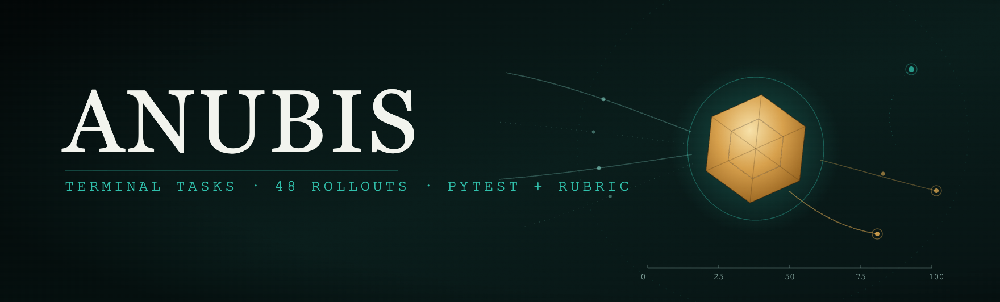
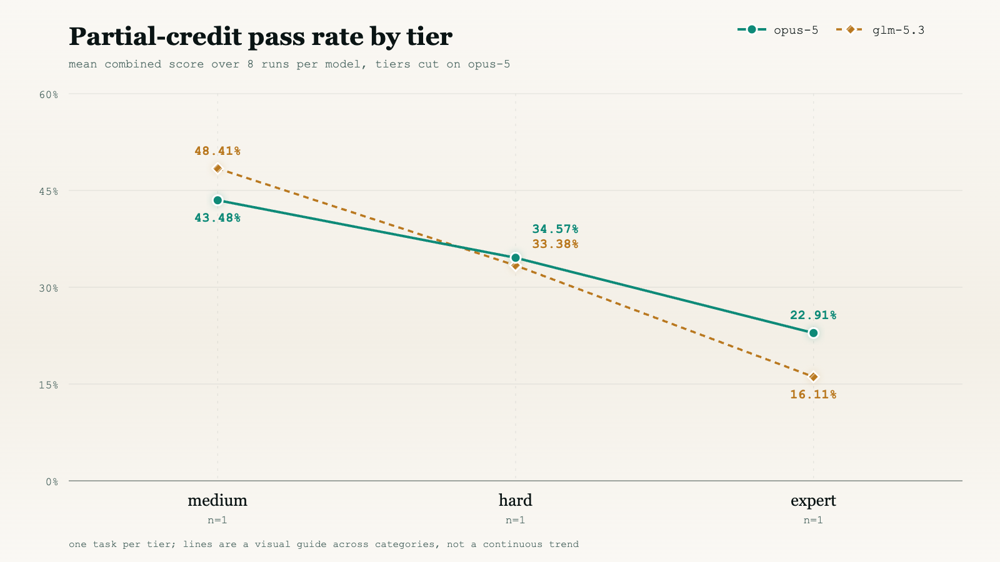
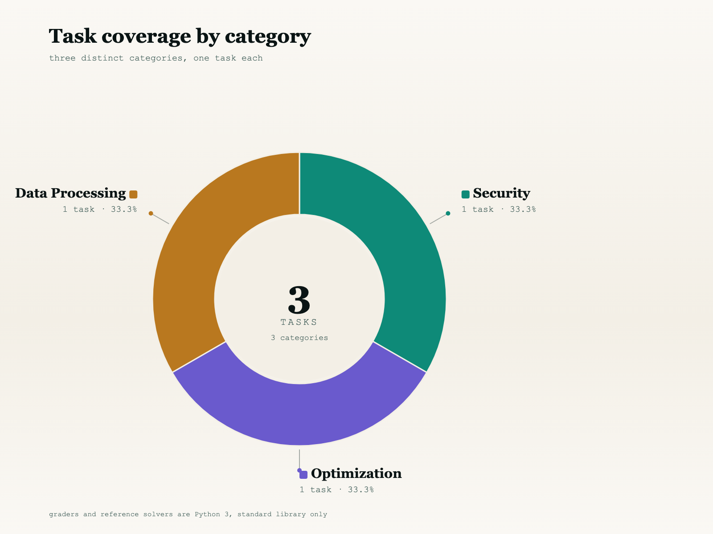
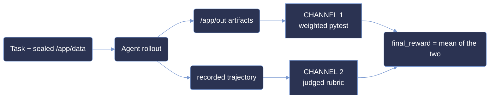

<p align="center">
  <picture>
    <source type="image/svg+xml" srcset="images/hero.svg">
    
  </picture>
</p>

<p align="center">
  <strong>Measuring agentic terminal capability on sealed, offline reconstruction tasks.</strong>
</p>

<p align="center">
  <a href="#summary"></a>
  <a href="#scoring-methodology"></a>
  <a href="#difficulty-tiers"></a>
  <a href="#summary"></a>
</p>

<p align="center"><sub>
  <a href="#summary">Summary</a> · <a href="#repository-layout">Layout</a> · <a href="#difficulty-tiers">Tiers</a> · <a href="#results">Results</a> · <a href="#analysis">Analysis</a> · <a href="#coverage">Coverage</a> · <a href="#dataset-structure">Dataset</a> · <a href="#trajectory-structure">Trajectories</a> · <a href="#scoring-methodology">Scoring</a> · <a href="#reproduction">Reproduction</a> · <a href="#limitations">Limitations</a>
</sub></p>

# ANUBIS: 3-Task Terminal Evaluation Sample

**ANUBIS measures agentic capability on sealed terminal tasks - problems whose governing
parameters are deliberately withheld and must be recovered from the shipped evidence before any
answer can be produced.**

Each task hands the agent a read-only corpus under `/app/data` and a set of output paths under
`/app/out`. Nothing tells the agent the seal parameters, the wire format constants, or the
settlement rules directly; those are recoverable only by reading the shipped policy documents and
reconciling them against the binary and tabular evidence. The agent then has to produce a byte-exact
report set.

This sample is narrow and deep: **3 tasks × 2 models × 8 runs = 48 graded rollouts.** The budget
goes on repetition rather than breadth, so difficulty is a measured rate over eight attempts rather
than a single observation.

The three tasks are one per tier - one `medium`, one `hard`, one `expert` - selected so that each
occupies a different band of opus-5's measured rate.

**Exactly one of the 48 runs turned every required test green** - `fb2f26ec` under `claude-opus-5`
on run 1, which scored 100% on the pytest channel and 97.5% on the rubric for a `final_reward` of
98.75. Every other run fell short, so an all-or-nothing metric would report 1/24 for opus-5 and
0/24 for glm-5.3 and separate almost nothing. Throughout this document the headline number is
therefore the mean `final_reward` over a model's 8 runs on a task, as a percentage:

```
pass_rate(task, model) = 100 × mean( final_reward over that model's 8 runs on the task )
```

**This is *not* pass@k.** It is a continuous partial-credit rate. A task scoring 43% did not solve
43% of the time; it earned 43% of the available credit on an average attempt.

> **This is a curated, quality-controlled sample of the ANUBIS corpus,** provided for evaluation.
> The dataset format, trajectory format and scoring are identical to the production benchmark.

## Summary

| Property         | Value                                                                       |
| :--------------- | :-------------------------------------------------------------------------- |
| Tasks            | **3**, across 3 distinct categories                                          |
| Models           | `claude-opus-5` and `glm-5.3`                                                |
| Runs & grid      | 8 per model per task = **48 total**; full 2 × 8 grid, no gaps                |
| Difficulty tiers | Banded on the mean `final_reward` of `claude-opus-5` over its 8 runs         |
| Judge            | `gpt-5.6-sol`, sole judge on all 48 runs                                     |
| Score            | `final_reward` ∈ [-1, 1] - mean of the pytest and rubric channels            |
| Language         | Python 3, standard library only                                              |
| Environment      | Verifier runs in a separate container after the agent rollout                |

| metric | opus-5 | glm-5.3 |
|---|--:|--:|
| **pass rate** (mean `final_reward`) | **31.10%** | 26.33% |
| full-task solves (`test == 100%`) | **1 / 24** | 0 / 24 |
| mean pytest channel | 16.45% | **18.29%** |
| mean rubric channel | **45.76%** | 34.38% |
| mean agent cost / run | **$6.79** | $9.65 |
| mean steps / run | **57.5** | 106.3 |

## Repository layout

```
anubis-samples/
├── README.md                     # this document
├── LICENSE                       # MIT
├── images/                       # charts ship in -light and -dark variants
│   ├── hero.{svg,png}
│   ├── pass_rate_by_tier-{light,dark}.{svg,png}
│   ├── cost_by_tier-{light,dark}.{svg,png}
│   └── tasks_by_category-{light,dark}.{svg,png}
├── scripts/
│   └── generate_charts.py        # stdlib-only; re-derives every figure and printed number
└── <uuid>/                       # one self-contained directory per task (3)
    ├── task.toml, instruction.md, environment/, solution/, tests/
    └── trajectories/
        ├── claude-opus-5/run_1 … run_8
        └── glm-5.3/run_1 … run_8
```

## Difficulty tiers

A tier is a **band on a measured score** - the mean `final_reward` over eight runs, computed on
`claude-opus-5` and used as the single calibration axis so tiers stay comparable across models:

| band | mean `final_reward` |
|---|---|
| `trivial` | ≥ 87.5% |
| `easy` | 50% – 87.5% |
| `medium` | 37.5% – 50% |
| `hard` | 25% – 37.5% |
| `expert` | < 25% |

`difficulty` in `task.toml` is the only label each bundle ships. Re-deriving all three from the
shipped scores reproduces all three exactly - see [Reproduction](#reproduction).

| tier | tasks | opus-5 pass rate |
|---|--:|--:|
| `medium` | 1 | 43.48% |
| `hard` | 1 | 35.39% |
| `expert` | 1 | 14.44% |

No task lands in `trivial` or `easy` under either model.

## Results

### Partial-credit pass rate by opus-5 tier

| tier | n | opus-5 pass rate | opus-5 pytest | opus-5 cost/run | glm-5.3 pass rate | glm-5.3 pytest | glm-5.3 cost/run |
|---|--:|--:|--:|--:|--:|--:|--:|
| `medium` | 1 | 43.48% | 14.23% | $4.09 | 48.41% | 18.98% | $9.09 |
| `hard` | 1 | 35.39% | 16.10% | $15.77 | 16.89% | 4.11% | $19.29 |
| `expert` | 1 | 14.44% | 19.01% | $0.53 | 13.69% | 31.77% | $0.56 |
| **overall** | 3 | **31.10%** | 16.45% | $6.79 | **26.33%** | 18.29% | $9.65 |

<picture>
  <source media="(prefers-color-scheme: dark)" srcset="images/pass_rate_by_tier-dark.svg" type="image/svg+xml">
  <source media="(prefers-color-scheme: light)" srcset="images/pass_rate_by_tier-light.svg" type="image/svg+xml">
  
</picture>

**opus-5 falls monotonically across the three tiers; glm-5.3 does not.** opus-5 goes
43.48 → 35.39 → 14.44, which is what banding on its own measured rate means - a tier *is* a band on
that number. glm-5.3 goes 48.41 → 16.89 → 13.69: it leads on `medium`, then collapses on `hard`
where it earns less than half of opus-5's rate. Tiers are cut on opus-5 only, so glm-5.3's ordering
is an observation, not a definition.

**The two channels rank the corpus in opposite directions.** On `expert`, glm-5.3 posts the highest
pytest score in the whole sample (31.77%) while its rubric channel goes **negative** (−4.39%) - it
produced output files that satisfy a good share of the deterministic checks while the judge actively
penalised the reasoning that produced them. On `hard`, the reverse: opus-5's rubric (54.69%) is more
than three times its pytest (16.10%). Reading either channel alone gives a different ranking of the
three tasks.

**Cost does not track the tier.** The `hard` task is by far the most expensive to attempt
($15.77 opus-5 / $19.29 glm-5.3) while the `expert` task is the cheapest in the sample
($0.53 / $0.56) - roughly a 30× spread driven by task shape and agent time budget, not by
difficulty. Across the sample, 48 runs consumed **$394.56**, 3,932 steps.

## Analysis

**Partial credit turns an unsolved corpus into a ranked one.** Zero of 48 runs passed every
required test, so a binary metric reports 0% for both models and says nothing. The continuous rate
separates them cleanly: opus-5 31.10% against glm-5.3 26.33%, and it separates the three tasks
across a 3× range.

**Eight runs make the label a measurement.** Every tier here is a band on a mean of eight
attempts, not a judgement call. Re-banding from the shipped scores reproduces all three declared
difficulties exactly, so the ladder is falsifiable against the bytes in this repository.

**Two independent channels catch different failures.** The pytest channel grades the delivered
artifacts; the rubric channel grades the recorded trajectory. The `expert` task shows why both are
needed - a submission can bank pytest credit while earning a negative rubric score, and averaging
the two is what stops that from reading as competence.

The separations hold because the grading resists gaming. The agent image contains only
`/app/data`: no test source, no reference solution, no expected outputs. Verification runs in a
separate container built from a different Dockerfile, after the rollout has finished, with `/tests`
stripped of group and world permissions. Every bundle carries negative-weight detectors that
subtract credit when a submission exhibits a cheat pattern, and those detectors fire - a stub
submission on the `expert` task scores **below zero**.

## Coverage

<picture>
  <source media="(prefers-color-scheme: dark)" srcset="images/tasks_by_category-dark.svg" type="image/svg+xml">
  <source media="(prefers-color-scheme: light)" srcset="images/tasks_by_category-light.svg" type="image/svg+xml">
  
</picture>

Three tasks across three distinct categories - Debugging, Machine Learning and Software
Engineering - with no shared verifier between them. Each ships its own `tests/test_output.py`,
its own weight table and its own reference solution. Every task is Python 3, standard library only,
with no network access required at solve time.

### Full task list

| uuid | category | tier | tests | positive total | detectors | opus-5 | glm-5.3 |
|---|---|---|--:|--:|--:|--:|--:|
| [`45421e59`](45421e59-0daa-505b-9656-e565f93c491c) | Debugging | `medium` | 35 | 137 | 4 | 43.48% | 48.41% |
| [`fb2f26ec`](fb2f26ec-6595-5389-8b6d-36e52ebf086b) | Machine Learning | `hard` | 22 | 73 | 5 | 35.39% | 16.89% |
| [`28a5e9c3`](28a5e9c3-0169-57f6-a810-d36a6a7db9d4) | Software Engineering | `expert` | 18 | 48 | 4 | 14.44% | 13.69% |

Tier is anchored on opus-5; the glm-5.3 column is that model's score on the identical task.

## Dataset structure

```
<uuid>/
├── task.toml               # schema_version, artifacts, task, metadata, verifier, agent, environment
├── instruction.md          # the brief handed to the agent - the only prose it receives
├── environment/
│   ├── Dockerfile          # agent image: base + apt + COPY data /app/data. Nothing else.
│   └── data/               # the sealed corpus, mounted read-only at /app/data
├── solution/
│   ├── solve.py            # reference implementation - verifier-only, never in the agent image
│   ├── solve.sh            # oracle entrypoint
│   └── TRUTH.md            # answer key and derivation notes
└── tests/
    ├── Dockerfile          # verifier image: separate build, chmod -R go-rwx /tests
    ├── test_output.py      # the graded assertions
    ├── test_weights.json   # per-test weights; negative weights are cheat detectors
    ├── rubric.json         # trajectory-graded criteria
    └── test.sh             # grader entrypoint; writes reward.json
```

The agent sees `instruction.md` and `/app/data`. It never sees `tests/` or `solution/` - neither is
referenced by any agent `Dockerfile`. `task.toml` declares `environment_mode = "separate"`, so the
verifier runs in its own container after the rollout completes.

## Trajectory structure

```
<uuid>/trajectories/<model>/run_N/
├── config.json             # the trial config as executed
├── result.json             # harness result envelope
├── report.json             # final_reward, test_weights_percentage, rubric_weights_percentage, judge_model
├── agent/
│   └── trajectory.json     # full agent transcript + final_metrics (cost, steps, tokens)
├── artifacts/
│   ├── app/out/            # what the agent actually produced
│   └── manifest.json       # source → destination map
└── verifier/
    ├── ctrf.json           # per-test pass/fail
    ├── reward.json         # the scalar reward
    ├── score.json          # rubric breakdown per criterion
    └── test-stdout.txt     # raw grader output
```

`report.json` carries the three numbers this document is built on: `test_weights_percentage`,
`rubric_weights_percentage`, and `final_reward` = their mean. `judge_model` is `gpt-5.6-sol` on all
48 runs. `agent/trajectory.json.final_metrics` carries `total_cost_usd`, `total_steps` and token
counts.

## Scoring methodology

Two channels are computed per run and averaged into the headline score.



### What "pass rate" means here

`test_weights_percentage` reaches 100 on exactly one of the 48 runs, so a conventional
all-or-nothing pass rate reports 1/24 for opus-5 and 0/24 for glm-5.3 - it separates the two models
but collapses all three tasks and both failure modes into a single bit. The rate used throughout is:

```
pass_rate(task, model) = 100 × mean( final_reward over that model's 8 runs )
```

It is a partial-credit rate aggregated as an unweighted mean, and it is the same number the
difficulty bands are cut on.

### Channel 1 – Weighted pytest

`tests/test.sh` loads `test_output.py` and `test_weights.json`, asserts a strict bijection between
the weighted names and the `test_*` attributes, then runs each test. A test contributes its weight
only when it passes. Positive weights sum to `positive_total`; the reward is
`clamp(raw / positive_total, -1, 1)`.

Negative weights are **cheat detectors**, written to pass when a submission exhibits the pattern
they hunt - hardcoded sample answers, filename-dependent behaviour, fabricated transcripts,
nondeterministic output. On an honest submission they stay silent and cost nothing; on a faked one
they subtract. This is why a stub can score below zero.

### Channel 2 – Judged rubric

`tests/rubric.json` grades the recorded trajectory rather than the delivered files, judged by
`gpt-5.6-sol` on every run. It is the channel that catches a submission which produced acceptable
artifacts by an unacceptable route - and on the `expert` task it returns a negative mean for
glm-5.3 while that model's pytest channel is the highest in the sample.

## Reproduction

Every figure and every number above re-derives from the shipped bytes; no re-execution is needed.

**Re-derive all three difficulty labels from the scores:**

```bash
python3 - <<'PY'
import json, glob, os
BANDS=[(87.5,"trivial"),(50.0,"easy"),(37.5,"medium"),(25.0,"hard")]
band=lambda x: next((n for lo,n in BANDS if x>=lo), "expert")
for u in sorted(d for d in os.listdir(".") if os.path.isdir(f"{d}/trajectories")):
    rs=[json.load(open(p)) for p in glob.glob(f"{u}/trajectories/claude-opus-5/run_*/report.json")]
    m=sum(r["final_reward"] for r in rs)/len(rs)
    declared=open(f"{u}/task.toml").read().split('difficulty = "')[1].split('"')[0]
    print(f"{u[:8]} declared={declared:7} mean={m:6.2f} band={band(m):7} {'OK' if band(m)==declared else 'MISMATCH'}")
PY
# -> 28a5e9c3 declared=expert  mean= 14.44 band=expert  OK
# -> 45421e59 declared=medium  mean= 43.48 band=medium  OK
# -> fb2f26ec declared=hard    mean= 35.39 band=hard    OK
```

**Compute the headline pass rate per model:**

```bash
python3 -c "
import json,glob
for m in ('claude-opus-5','glm-5.3'):
    rs=[json.load(open(p)) for p in glob.glob(f'*/trajectories/{m}/run_*/report.json')]
    print(m, {'runs':len(rs),'pass_rate':round(sum(r[\"final_reward\"] for r in rs)/len(rs),2)})"
# -> claude-opus-5 {'runs': 24, 'pass_rate': 31.1}
# -> glm-5.3 {'runs': 24, 'pass_rate': 26.33}
```

**Confirm the grid is complete, nothing solved outright, one judge throughout:**

```bash
python3 -c "
import json,glob
rs=[json.load(open(p)) for p in glob.glob('*/trajectories/*/run_*/report.json')]
print({'runs':len(rs),'solved':sum(r['test_weights_percentage']>=100 for r in rs),'judges':sorted({r['judge_model'] for r in rs})})"
# -> {'runs': 48, 'solved': 1, 'judges': ['gpt-5.6-sol']}
```

**Verify the composition `final_reward = (pytest + rubric) / 2`:**

All three score fields ship rounded to two decimal places, so the composition is checked at `0.01`
rather than exactly. The largest deviation observed across the corpus is `0.005` - exactly the
half-cent rounding boundary.

```bash
python3 -c "
import json,glob
ok=worst=0
for p in glob.glob('*/trajectories/*/run_*/report.json'):
    r=json.load(open(p))
    d=abs((r['test_weights_percentage']+r['rubric_weights_percentage'])/2-r['final_reward'])
    worst=max(worst,d); ok+= d<0.01
print(f'{ok}/48 ok, worst={worst:.3f}')"
# -> 48/48 ok, worst=0.005
```

**Split the two channels per task and model:**

```bash
python3 -c "
import json,glob,os
for u in sorted(d for d in os.listdir('.') if os.path.isdir(f'{d}/trajectories')):
    for m in ('claude-opus-5','glm-5.3'):
        rs=[json.load(open(p)) for p in glob.glob(f'{u}/trajectories/{m}/run_*/report.json')]
        t=sum(r['test_weights_percentage'] for r in rs)/8; b=sum(r['rubric_weights_percentage'] for r in rs)/8
        print(f'{u[:8]} {m:15} pytest={t:6.2f} rubric={b:6.2f} final={(t+b)/2:6.2f}')"
# -> 28a5e9c3 claude-opus-5   pytest= 19.01 rubric=  9.87 final= 14.44
# -> 28a5e9c3 glm-5.3         pytest= 31.77 rubric= -4.39 final= 13.69
# -> 45421e59 claude-opus-5   pytest= 14.23 rubric= 72.73 final= 43.48
# -> 45421e59 glm-5.3         pytest= 18.98 rubric= 77.84 final= 48.41
# -> fb2f26ec claude-opus-5   pytest= 16.10 rubric= 54.69 final= 35.39
# -> fb2f26ec glm-5.3         pytest=  4.11 rubric= 29.69 final= 16.90
```

**Total agent effort across the sample:**

```bash
python3 -c "
import json,glob
m=[json.load(open(p))['final_metrics'] for p in glob.glob('*/trajectories/*/run_*/agent/trajectory.json')]
print({'runs':len(m),'usd':round(sum(x['total_cost_usd'] for x in m),2),'steps':sum(x['total_steps'] for x in m)})"
# -> {'runs': 48, 'usd': 394.56, 'steps': 3932}
```

**Count the graders and confirm no two tasks share one:**

```bash
python3 -c "
import json,glob,hashlib
w=sorted(glob.glob('*/tests/test_weights.json')); items=[json.load(open(p)) for p in w]
print({'tests':sum(len(i) for i in items),'negative':sum(1 for i in items for v in i.values() if v<0),'distinct_graders':len({hashlib.sha256(open(p,'rb').read()).hexdigest() for p in w})})"
# -> {'tests': 75, 'negative': 13, 'distinct_graders': 3}
```

**Confirm no task name leaks into the shipped bytes:**

```bash
grep -rIl -e 'crash-cohort' -e 'inference-scorer' -e 'registry-service' */ | wc -l
# -> 0
```

**Regenerate every figure from the shipped data:**

```bash
python3 scripts/generate_charts.py
```

The script is stdlib-only and hand-writes SVG. It emits SVG only - the matching `.png` fallbacks are
browser-rendered exports of those exact files, not output of this script. It also prints a plain-text
summary; diff those numbers against this document and they are the same numbers, computed the same
way, from the same files.

## Limitations

**Three tasks is a small corpus.** These figures characterise these three tasks, not the authoring
process behind them. Per-task rates rest on 8 runs each; the corpus aggregate rests on 24 per model.

**The sample is not random.** These three were selected for tier coverage and for passing an
internal QA review, so aggregate statistics should not be read as an estimate of the wider corpus.

**The ceiling is reached once, on one task.** `fb2f26ec` under opus-5 run 1 scored 100% pytest and
97.5% rubric, so a real model - not just the oracle - has demonstrated the top of the scale on that
task. The other two tasks were never fully solved by either model, so their ceilings rest on the
reference solution alone, which reaches `1.0` on all three.

**Sampling temperature is uncontrolled.** Neither cohort pins a temperature; provider defaults
apply and are not known to match across the two.

**The rubric channel depends on a single judge.** `gpt-5.6-sol` grades every run. No inter-judge
agreement was measured, so rubric scores carry that model's biases.

**Two tasks lack a machine-checkable output schema.** `fb2f26ec` and `28a5e9c3` define no explicit
key-set constant in their test files, so an automated check that every asserted output key is
discoverable from `/app/data` could not be run against them. Their runtime behaviour is verified;
schema reachability is not.

## License

MIT © 2026 Ethara.AI – see [LICENSE](LICENSE).

Task content, including the corpora under `environment/data/`, is released under the same terms.
