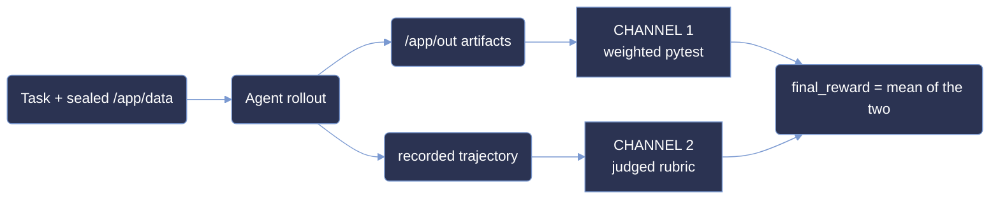

<p align="center">
  <picture>
    <source type="image/svg+xml" srcset="images/hero.svg">
    
  </picture>
</p>

<p align="center">
  <strong>Measuring agentic terminal capability on sealed, offline reconstruction tasks.</strong>
</p>

<p align="center">
  <a href="#summary"></a>
  <a href="#scoring-methodology"></a>
  <a href="#difficulty-tiers"></a>
  <a href="#summary"></a>
</p>

<p align="center"><sub>
  <a href="#summary">Summary</a> · <a href="#repository-layout">Layout</a> · <a href="#difficulty-tiers">Tiers</a> · <a href="#results">Results</a> · <a href="#analysis">Analysis</a> · <a href="#coverage">Coverage</a> · <a href="#dataset-structure">Dataset</a> · <a href="#trajectory-structure">Trajectories</a> · <a href="#scoring-methodology">Scoring</a> · <a href="#reproduction">Reproduction</a> · <a href="#limitations">Limitations</a>
</sub></p>

# ANUBIS: 3-Task Terminal Evaluation Sample

**ANUBIS measures agentic capability on sealed terminal tasks - problems whose governing
parameters are deliberately withheld and must be recovered from the shipped evidence before any
answer can be produced.**

Each task hands the agent a read-only corpus under `/app/data` and a set of output paths under
`/app/out`. Nothing tells the agent which layer wins a precedence conflict, which rows in a shipped
table are authoritative, or which rounding rule governs a derived quantity - in `Security` it is the
active enforcement class, in `Optimization` the order in which protected floors and capacity limits
bind, in `Data Processing` the placement and contention rules that break a dependency cycle. Those
are recoverable only by reading the shipped policy layers and reconciling them against the tabular
and binary evidence, which is seeded with decoy rows throughout. The agent then has to produce a
byte-exact report set.

This sample is narrow: **3 tasks × 2 models × 1 run = 6 graded rollouts.** Every figure below is a
single observation per cell, with no variance estimate. Read it as a worked example of the task
format, the grading and the trajectory record - not as a benchmark measurement.

**No run in this sample passed every required test.** The best pytest channel score is 44.94%, so an
all-or-nothing metric would report 0/3 for both models and separate nothing at all. Throughout this
document the headline number is therefore the `final_reward` of the recorded run. `report.json`
already stores that field in percentage points, so no rescaling is applied anywhere below:

```
pass_rate(task, model) = final_reward on that model's recorded run
                       = (test_weights_percentage + rubric_weights_percentage) / 2
```

**This is *not* pass@k.** It is a continuous partial-credit rate. A task scoring 45% was not solved
45% of the time; that attempt earned 45% of the available credit.

> **This is a curated, quality-controlled sample of the ANUBIS corpus,** provided for evaluation.
> The dataset format, trajectory format and scoring are identical to the production benchmark.

## Summary

| Property         | Value                                                                       |
| :--------------- | :-------------------------------------------------------------------------- |
| Tasks            | **3**, across 3 distinct categories                                          |
| Models           | `claude-opus-5` and `glm-5.3`                                                |
| Runs & grid      | 2 models × 1 run for each of the 3 tasks = **6 total**, no gaps               |
| Difficulty tiers | Banded on the `final_reward` of `claude-opus-5`                              |
| Judge            | Human-evaluated on all 6 runs                                                |
| Score            | `final_reward`, percentage points in [-100, 100] - mean of the two channels  |
| Language         | Python 3, standard library only                                              |
| Environment      | Verifier runs in a separate container after the agent rollout                |

| metric | opus-5 | glm-5.3 |
|---|--:|--:|
| **pass rate** (mean `final_reward`) | **45.73%** | 42.93% |
| full-task solves (`test == 100%`) | 0 / 3 | 0 / 3 |
| mean pytest channel | 28.02% | **35.38%** |
| mean rubric channel | **63.43%** | 50.48% |
| mean agent cost / run | **$3.36** | not recorded |
| mean steps / run | **33.7** | 129.0 |

## Repository layout

```
anubis-samples/
├── README.md                     # this document
├── LICENSE                       # MIT
├── images/                       # charts ship in -light and -dark SVG; PNG fallback is -light
│   ├── hero.{svg,png}
│   ├── pass_rate_by_tier-{light,dark}.svg + pass_rate_by_tier-light.png
│   └── tasks_by_category-{light,dark}.svg + tasks_by_category-light.png
└── <uuid>/                       # one self-contained directory per task (3)
    ├── task.toml, instruction.md, README.md, environment/, solution/, tests/
    └── trajectories/
        ├── claude-opus-5/run_1
        └── glm-5.3/run_1
```

## Difficulty tiers

A tier is a **band on a measured score** - the `final_reward` of `claude-opus-5`, used as the single
calibration axis so tiers stay comparable across models:

| band | `final_reward` | interval |
|---|---|---|
| `trivial` | 87.5% and above | `[87.5, 100]` |
| `easy` | 50% up to but excluding 87.5% | `[50, 87.5)` |
| `medium` | 37.5% up to but excluding 50% | `[37.5, 50)` |
| `hard` | 25% up to but excluding 37.5% | `[25, 37.5)` |
| `expert` | below 25% | `(-100, 25)` |

Every bound is **lower-inclusive, upper-exclusive**: a score of exactly 50.0 is `easy`, exactly 37.5
is `medium`, exactly 25.0 is `hard`. The Reproduction snippet below implements this convention
verbatim.

`difficulty` in `task.toml` is the only label each bundle ships. Re-deriving all three from the
shipped scores reproduces all three exactly - see [Reproduction](#reproduction).

| tier | tasks | opus-5 pass rate |
|---|--:|--:|
| `easy` | 1 | 50.89% |
| `medium` | 1 | 48.94% |
| `hard` | 1 | 37.36% |

No task lands in `trivial` or `expert`. Because each band is cut on one observation, two of the
three sit close to a boundary - see [Limitations](#limitations).

## Results

### Partial-credit pass rate by opus-5 tier

| tier | category | opus-5 pass rate | opus-5 pytest | opus-5 rubric | glm-5.3 pass rate | glm-5.3 pytest | glm-5.3 rubric |
|---|---|--:|--:|--:|--:|--:|--:|
| `easy` | Security | 50.89% | 28.16% | 73.63% | 45.91% | 20.39% | 71.43% |
| `medium` | Optimization | 48.94% | 41.20% | 56.67% | 37.47% | 44.94% | 30.00% |
| `hard` | Data Processing | 37.36% | 14.71% | 60.00% | 45.41% | 40.81% | 50.00% |
| **overall** | 3 | **45.73%** | 28.02% | 63.43% | **42.93%** | 35.38% | 50.48% |

<picture>
  <source media="(prefers-color-scheme: dark)" srcset="images/pass_rate_by_tier-dark.svg" type="image/svg+xml">
  <source media="(prefers-color-scheme: light)" srcset="images/pass_rate_by_tier-light.svg" type="image/svg+xml">
  
</picture>

**opus-5's decline across the three tiers is a tautology, not a result.** It goes
50.89 → 48.94 → 37.36 because the tier *is* a band on that number; the line can only ever slope
down. The informative series is the other one. glm-5.3 goes 45.91 → 37.47 → 45.41, which is not
monotonic, and on the `hard` task it beats opus-5 outright - 45.41% against 37.36%, the only
combined-score cell in the sample where glm-5.3 finishes ahead.

**The two channels rank the two models in opposite directions.** On the deterministic pytest
channel glm-5.3 leads, 35.38% against 28.02%, and it leads on two of the three tasks - most
sharply on `hard`, where it scores 40.81% against opus-5's 14.71%. On the judged rubric channel the
order reverses and the gap widens: opus-5 63.43% against 50.48%, ahead on every task. Averaging the
two is what produces the narrow 45.73% / 42.93% headline; either channel read alone would name a
different winner.

**Effort does not track score.** glm-5.3 spends 129.0 steps per run against opus-5's 33.7 - roughly
3.8× the interaction - and still finishes 2.8 points lower overall. Cost cannot be compared: the
harness recorded `total_cost_usd` for all three opus-5 runs ($10.09 total, $3.36 per run) and
recorded `0.0` for all three glm-5.3 runs, so every cost figure in this document is opus-5 only.

## Analysis

**Partial credit turns an unsolved corpus into a ranked one.** Zero of 6 runs passed every required
test, so a binary metric reports 0% for both models and says nothing. The continuous rate separates
the models (45.73% against 42.93%) and spreads the three tasks across 37.36% – 50.89%.

**One run per cell is an example, not a measurement.** Each number here is a single observation, so
nothing in this document supports a claim about variance, and the difficulty ladder rests on three
individual opus-5 scores rather than on a stable mean.

**Two independent channels catch different failures.** The pytest channel grades the delivered
artifacts; the rubric channel grades the recorded trajectory. They disagree systematically in this
sample - glm-5.3 produces output files that satisfy more of the deterministic checks while earning
consistently lower marks for the route it took to get there. Averaging the two is what stops either
kind of partial success from reading as competence.

**The anti-cheat channel is live, not decorative.** The three bundles ship 12 negative-weight
detectors and 15 negative rubric criteria. One detector fired in this sample:
`test_negative_weight_fake_cli_transcript` on `c4a9a9b2` under glm-5.3, which subtracted 3 points
from a run that had earned 24, taking it to 21/103 = 20.39%. No negative rubric criterion was
violated in any of the 6 rollouts.

The separations hold because the grading resists gaming. The agent image contains only
`/app/data`: no test source, no reference solution, no expected outputs. Verification runs in a
separate container built from a different Dockerfile, after the rollout has finished, with `/tests`
stripped of group and world permissions. Both containers run with `network_mode = "no-network"`, so
nothing can be fetched at solve time or at grade time.

## Coverage

<picture>
  <source media="(prefers-color-scheme: dark)" srcset="images/tasks_by_category-dark.svg" type="image/svg+xml">
  <source media="(prefers-color-scheme: light)" srcset="images/tasks_by_category-light.svg" type="image/svg+xml">
  
</picture>

Three tasks across three distinct categories - Security, Optimization and Data Processing - with no
shared verifier between them. Each ships its own `tests/test_output.py`, its own weight table and
its own reference solution; the three weight tables are byte-distinct. Every task is Python 3,
standard library only, with no network access at solve time.

### Full task list

| uuid | category | tier | tests | positive total | detectors | opus-5 | glm-5.3 |
|---|---|---|--:|--:|--:|--:|--:|
| [`c4a9a9b2`](c4a9a9b2-0818-5b05-9829-3a208c74638b) | Security | `easy` | 33 | 103 | 4 | 50.89% | 45.91% |
| [`a8d5a61c`](a8d5a61c-4126-58f3-8e29-edb360f79699) | Optimization | `medium` | 75 | 267 | 4 | 48.94% | 37.47% |
| [`64d3d25b`](64d3d25b-74db-5ac0-a47d-f1b1073cca81) | Data Processing | `hard` | 76 | 272 | 4 | 37.36% | 45.41% |

Tier is anchored on opus-5; the glm-5.3 column is that model's score on the identical task. Across
the three bundles: 184 weighted tests, 642 positive points, 12 cheat detectors, and 58 rubric
criteria of which 43 are positive.

## Dataset structure

```
<uuid>/
├── task.toml               # schema_version, artifacts, task, metadata, verifier, agent, environment
├── instruction.md          # the brief handed to the agent - the only prose it receives
├── README.md               # maintainer notes; never shown to the agent
├── environment/
│   ├── Dockerfile          # agent image: base + apt + COPY data /app/data. Nothing else.
│   └── data/               # the sealed corpus, baked into the image layer at /app/data
├── solution/
│   ├── solve.py            # reference implementation - verifier-only, never in the agent image
│   ├── solve.sh            # oracle entrypoint
│   └── TRUTH.md            # answer key and derivation notes
└── tests/
    ├── Dockerfile          # verifier image: separate build, chmod -R go-rwx /tests
    ├── test_output.py      # the graded assertions
    ├── test_weights.json   # per-test weights; negative weights are cheat detectors
    ├── rubric.json         # trajectory-graded criteria
    └── test.sh             # grader entrypoint; writes reward.json
```

The agent is handed `instruction.md` by the harness and finds the corpus on disk at `/app/data`. It
never sees `tests/` or `solution/` - neither is referenced by any agent `Dockerfile`. `task.toml`
declares `environment_mode = "separate"`, so the verifier runs in its own container after the
rollout completes. Both containers are pinned by digest: `[environment].docker_image` and
`[verifier.environment].docker_image` each name an image by `sha256`, so a re-run pulls the exact
bytes these trajectories were recorded against instead of rebuilding from the `Dockerfile`.

## Trajectory structure

```
<uuid>/trajectories/<model>/
├── pass_summary.json       # runs, average_combined_score, per-run breakdown
└── run_1/
    ├── config.json         # the trial config as executed
    ├── result.json         # harness result envelope
    ├── report.json         # final_reward, test_weights_percentage, rubric_weights_percentage, judge
    ├── agent/
    │   └── trajectory.json # full agent transcript + final_metrics (cost, tokens)
    ├── artifacts/
    │   ├── app/out/        # what the agent actually produced
    │   ├── logs/           # reserved for agent-side logs; empty in all 6 runs (manifest: "empty")
    │   └── manifest.json   # source → destination map
    └── verifier/
        ├── ctrf.json       # per-test pass/fail
        ├── reward.json     # the scalar reward
        ├── score.json      # rubric breakdown per criterion
        └── test-stdout.txt # raw grader output
```

`report.json` carries the three numbers this document is built on: `test_weights_percentage`,
`rubric_weights_percentage`, and `final_reward` = their mean. Its `judge` field reads
`human-evaluated` on all 6 runs. `agent/trajectory.json.final_metrics` carries `total_cost_usd` and
token counts; step counts are the length of the `steps` array rather than a stored total.

## Scoring methodology

Two channels are computed per run and averaged into the headline score.



### What "pass rate" means here

`test_weights_percentage` never reaches 100 in this sample, so a conventional all-or-nothing pass
rate reports 0/3 for both models and collapses all three tasks and both failure modes into a single
bit. The rate used throughout is:

```
pass_rate(task, model) = final_reward on that model's recorded run
```

`final_reward` is stored in percentage points and ranges over `[-100, 100]`: it can go negative,
because both channels subtract penalties from a denominator built only from the positive weights.
It is a partial-credit rate, and it is the same number the difficulty bands are cut on.

The per-run `result.json` carries a different, narrower number - `verifier_result.rewards.reward`,
the pytest channel alone, normalised to `[0, 1]`. It is not the figure this document reports.

### Channel 1 – Weighted pytest

`tests/test.sh` loads `test_output.py` and `test_weights.json`, asserts a strict bijection between
the weighted names and the `test_*` attributes, then runs each test. A test contributes its weight
only when it passes. Positive weights sum to `positive_total`; the reward is
`clamp(raw / positive_total, -1, 1)`.

Negative weights are **cheat detectors**, written to pass when a submission exhibits the pattern
they hunt - hardcoded sample answers, filename-dependent behaviour, fabricated transcripts,
nondeterministic output. On an honest submission they stay silent and cost nothing; on a faked one
they subtract while the denominator stays positive-weight only. This is why a stub can score below
zero, and why one glm-5.3 run in this sample lost 3 of the 24 points it had earned.

### Channel 2 – Judged rubric

`tests/rubric.json` grades the recorded trajectory rather than the delivered files. Each criterion
carries a `score`, an `importance` and an `is_positive` flag; positive criteria award their score
when met, negative criteria subtract theirs when violated, and the denominator is the positive
total. Grading for this sample was **human-evaluated** - every run's `judge` field reads
`human-evaluated`, and no model judge was used. It is the channel that catches a submission which
produced acceptable artifacts by an unacceptable route, and it is where the two models separate
most clearly here.

## Reproduction

Every figure and every number above re-derives from the shipped bytes; no re-execution is needed.
Run these from the repository root.

**Re-derive all three difficulty labels from the scores:**

```bash
python3 - <<'PY'
import json, glob, os
# lower bound inclusive, upper bound exclusive; anything below 25 is expert
BANDS=[(87.5,"trivial"),(50.0,"easy"),(37.5,"medium"),(25.0,"hard")]
band=lambda x: next((n for lo,n in BANDS if x>=lo), "expert")
for u in sorted(d for d in os.listdir(".") if os.path.isdir(f"{d}/trajectories")):
    rs=[json.load(open(p)) for p in glob.glob(f"{u}/trajectories/claude-opus-5/run_*/report.json")]
    m=sum(r["final_reward"] for r in rs)/len(rs)
    declared=open(f"{u}/task.toml").read().split('difficulty = "')[1].split('"')[0]
    print(f"{u[:8]} declared={declared:7} opus-5={m:6.2f} band={band(m):7} {'OK' if band(m)==declared else 'MISMATCH'}")
PY
# -> 64d3d25b declared=hard    opus-5= 37.36 band=hard    OK
# -> a8d5a61c declared=medium  opus-5= 48.94 band=medium  OK
# -> c4a9a9b2 declared=easy    opus-5= 50.89 band=easy    OK
```

**Compute the headline pass rate per model:**

```bash
python3 -c "
import json,glob
for m in ('claude-opus-5','glm-5.3'):
    rs=[json.load(open(p)) for p in glob.glob(f'*/trajectories/{m}/run_*/report.json')]
    print(m, {'runs':len(rs),'pass_rate':round(sum(r[\"final_reward\"] for r in rs)/len(rs),2)})"
# -> claude-opus-5 {'runs': 3, 'pass_rate': 45.73}
# -> glm-5.3 {'runs': 3, 'pass_rate': 42.93}
```

**Confirm the grid is complete, nothing solved outright, one grading regime throughout:**

```bash
python3 -c "
import json,glob
rs=[json.load(open(p)) for p in glob.glob('*/trajectories/*/run_*/report.json')]
print({'runs':len(rs),'solved':sum(r['test_weights_percentage']>=100 for r in rs),'judges':sorted({r['judge'] for r in rs})})"
# -> {'runs': 6, 'solved': 0, 'judges': ['human-evaluated']}
```

**Verify the composition `final_reward = (pytest + rubric) / 2`:**

All three score fields ship rounded to two decimal places, so the composition is checked at `0.01`
rather than exactly. The largest deviation observed across the corpus is `0.005` - exactly the
half-cent rounding boundary.

```bash
python3 -c "
import json,glob
ok=worst=0
for p in glob.glob('*/trajectories/*/run_*/report.json'):
    r=json.load(open(p))
    d=abs((r['test_weights_percentage']+r['rubric_weights_percentage'])/2-r['final_reward'])
    worst=max(worst,d); ok+= d<0.01
print(f'{ok}/6 ok, worst={worst:.3f}')"
# -> 6/6 ok, worst=0.005
```

**Split the two channels per task and model:**

```bash
python3 -c "
import json,glob,os
for u in sorted(d for d in os.listdir('.') if os.path.isdir(f'{d}/trajectories')):
    for m in ('claude-opus-5','glm-5.3'):
        rs=[json.load(open(p)) for p in glob.glob(f'{u}/trajectories/{m}/run_*/report.json')]
        n=len(rs)
        t=sum(r['test_weights_percentage'] for r in rs)/n; b=sum(r['rubric_weights_percentage'] for r in rs)/n
        print(f'{u[:8]} {m:15} pytest={t:6.2f} rubric={b:6.2f} final={(t+b)/2:6.2f}')"
# -> 64d3d25b claude-opus-5   pytest= 14.71 rubric= 60.00 final= 37.36
# -> 64d3d25b glm-5.3         pytest= 40.81 rubric= 50.00 final= 45.41
# -> a8d5a61c claude-opus-5   pytest= 41.20 rubric= 56.67 final= 48.94
# -> a8d5a61c glm-5.3         pytest= 44.94 rubric= 30.00 final= 37.47
# -> c4a9a9b2 claude-opus-5   pytest= 28.16 rubric= 73.63 final= 50.89
# -> c4a9a9b2 glm-5.3         pytest= 20.39 rubric= 71.43 final= 45.91
```

**Total agent effort across the sample:**

Only 3 of the 6 trajectories carry a non-zero `total_cost_usd`; the three glm-5.3 runs record
`0.0`, which is why cost is reported for opus-5 only.

```bash
python3 -c "
import json,glob
M=[json.load(open(p)) for p in glob.glob('*/trajectories/*/run_*/agent/trajectory.json')]
print({'runs':len(M),'usd':round(sum(x['final_metrics']['total_cost_usd'] for x in M),2),'steps':sum(len(x['steps']) for x in M),'runs_with_cost':sum(x['final_metrics']['total_cost_usd']>0 for x in M)})"
# -> {'runs': 6, 'usd': 10.09, 'steps': 488, 'runs_with_cost': 3}
```

**Count the graders and confirm no two tasks share one:**

```bash
python3 -c "
import json,glob,hashlib
w=sorted(glob.glob('*/tests/test_weights.json')); items=[json.load(open(p)) for p in w]
print({'tests':sum(len(i) for i in items),'negative':sum(1 for i in items for v in i.values() if v<0),'distinct_graders':len({hashlib.sha256(open(p,'rb').read()).hexdigest() for p in w})})"
# -> {'tests': 184, 'negative': 12, 'distinct_graders': 3}
```

**List every cheat detector that fired:**

```bash
python3 -c "
import json,glob
print([(p.split('/')[0][:8],p.split('/')[2],t['name'])
       for p in glob.glob('*/trajectories/*/run_*/report.json')
       for t in json.load(open(p))['pytest']['tests'] if t['weight']<0 and t['passed']])"
# -> [('c4a9a9b2', 'glm-5.3', 'test_negative_weight_fake_cli_transcript')]
```

**Confirm no agent `Dockerfile` references the `tests/` or `solution/` trees:**

```bash
grep -rIlw -e 'tests' -e 'solution' */environment/Dockerfile | wc -l
# -> 0
```

The agent build context is `environment/` alone, so `tests/` and `solution/` are not reachable by a
`COPY` even if one were written. The only network fetch in those Dockerfiles is the `uv` installer
used to build the agent's own Python toolchain.

Every snippet above reads only files shipped in this repository and needs nothing beyond the Python 3
standard library. The charts in `images/` plot the same numbers these snippets print: the `-light`
and `-dark` SVGs are the sources, and the `-light.png` files are browser-rendered exports of them.

## Limitations

**One run per model per task.** Each cell is a single observation. No variance, confidence interval
or pass@k statement is supported by this data, and a re-run could move any figure.

**The difficulty ladder rests on three single scores, and two of them sit near a boundary.**
`c4a9a9b2` is 0.89 points above the `easy`/`medium` line at 50.89%, and `64d3d25b` is 0.14 points
below the `medium`/`hard` line at 37.36%. A second opus-5 run could plausibly re-band either task.

**Three tasks is a small corpus, and the sample is not random.** These three were selected for tier
and category coverage and for passing an internal QA review, so aggregate statistics should not be
read as an estimate of the wider corpus.

**The ceiling was never reached by a model.** No run scored 100% on the pytest channel; the best is
44.94%. Each task's reference solution does take the pytest channel to its maximum - the verifier
writes a normalised `reward` of `1.0`, i.e. `test_weights_percentage = 100` - so the ceiling is known
to be attainable, but only by the oracle.

**Sampling is not pinned to a reproducible point.** Both cohorts record
`LLM_TEMPERATURE = "1.0"` in `run_1/config.json`, so the temperature is matched across them, but no
seed is recorded and provider-side sampling above that knob is not guaranteed identical between two
vendors. A re-run will not reproduce these trajectories token for token.

**glm-5.3 cost was not captured.** All three glm-5.3 trajectories record `total_cost_usd = 0.0`,
which reflects the harness configuration rather than a free rollout. Cost comparisons between the
two models are therefore impossible from this data.

**The rubric channel was graded by humans, once.** Every run's `judge` field reads
`human-evaluated`. No second pass and no inter-rater agreement were recorded, so the rubric scores
carry the biases of a single grading pass and cannot be re-derived from the bytes the way the pytest
channel can.

## License

MIT © 2026 Ethara.AI – see [LICENSE](LICENSE).

Task content, including the corpora under `environment/data/`, is released under the same terms.
